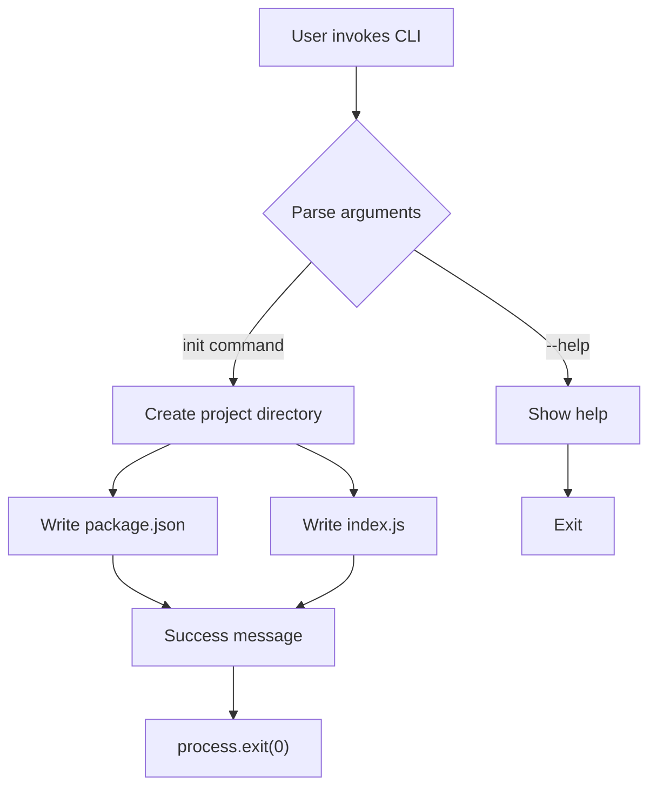

# DevFlow Scaffold CLI

**Instant project scaffolding for modern developer workflows**

[](https://opensource.org/licenses/MIT) 
[](https://nodejs.org/) 
[](https://github.com/yourusername/devflow-scaffold-cli) 
[](#) 
[](#)

---

## Installation & Quick Start

```bash
# Clone the repository
git clone https://github.com/yourusername/devflow-scaffold-cli.git
cd devflow-scaffold-cli

# Run the CLI directly with Node
node src/index.js init my-awesome-project
```

The command above creates a `my-awesome-project` folder containing a minimal `package.json` and an `index.js` starter file.

---

## Visual Terminal Showcase

```bash
$ devflow-scaffold init hello-world
Project "hello-world" created successfully.
$ ls hello-world
index.js  package.json
$ cat hello-world/index.js
console.log('Hello from hello-world!');
```

---

## Architecture Flowchart



---

## Test Results

## 🧪 Real-World Test Telemetry

> [!NOTE]
> Verified automatically using Node.js native test runner (`node:test` & `node:assert/strict`).

```bash
▶ node --test
TAP version 13
# Subtest: CLI creates project scaffold
ok 1 - CLI creates project scaffold
  ---
  duration_ms: 34.74831
  ...
1..1
# tests 1
# suites 0
# pass 1
# fail 0
# cancelled 0
# skipped 0
# todo 0
# duration_ms 79.675529
```

---

## License

MIT License © 2026 Suman Mehta